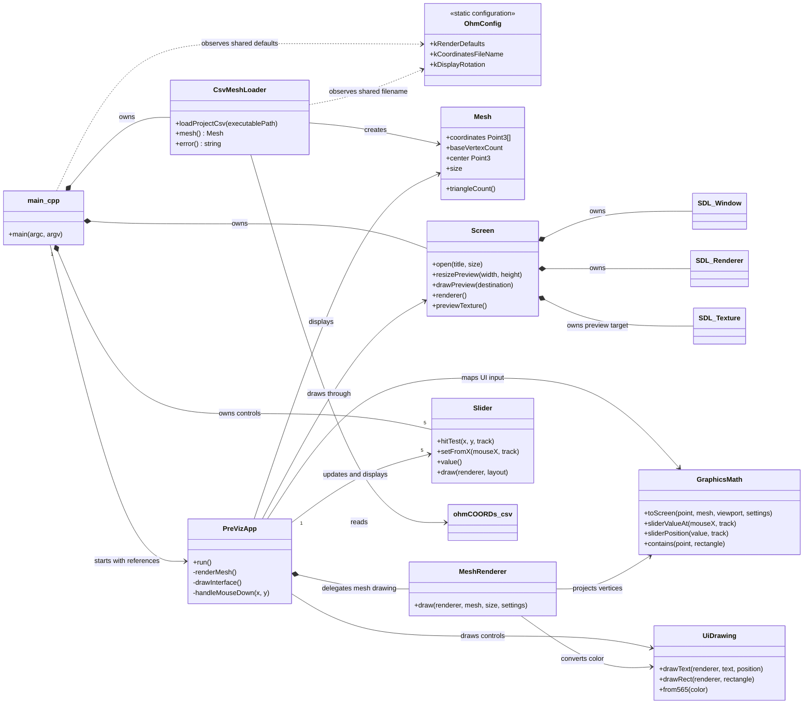
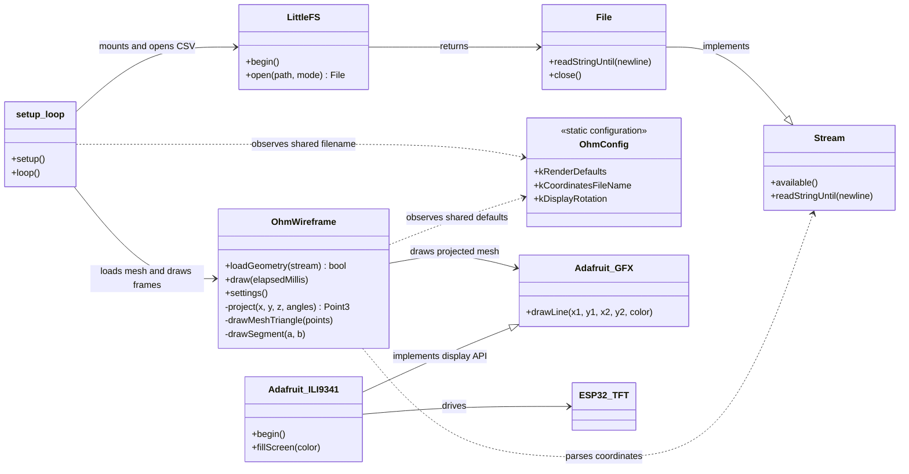

# ohmegaPHONE

This repository serves to hold the firmware using PlatformIO to compile and serve binaries for the ESP32 devkit board (and later on, onto a Daisy Seed).

Hardware specs:
- ESP32
- TFT Screen 2.4in 240x320 RGB LCD Display


### Compilation:
```
pio run             # compile binaries
pio run -t upload   # flash onto firmware
pio run -t uploadfs # upload data/ files to the ESP32 LittleFS filesystem


pio device list     # run this if device is not showing up at all
pio run -t upload --upload-port /dev/cu.usbserial-0001
# example device

pio device monitor  # use this to montior serial outputs

```

The Ω mesh is loaded from `data/ohmCOORDs.csv` at startup. After changing the
CSV, run `pio run -t uploadfs` to update the board's LittleFS data.

### Pre-viz

Preview the Ω before flashing. From the repo root, run `cd pre-viz && cmake -S . -B build && cmake --build build && ./build/ohmega_previz` to build and open it. Requires CMake and SDL2.

The pre-viz is split into small modules. `main.cpp` constructs the
`CsvMeshLoader`, `Screen`, and slider components, then passes them to
`PreVizApp`. Mesh rendering, graphics calculations, and SDL drawing helpers
are separate modules. The loader reads the shared CSV directly, so changing
coordinates does not require editing pre-viz code. The pre-viz uses composition
between these collaborators; it has no artificial class inheritance because
the screen and sliders are not specializations of one another.

Shared compile-time defaults and the coordinate filename live in
[`include/OhmConfig.h`](include/OhmConfig.h). Both the pre-viz and firmware use
that header, so common startup values have one source and add no runtime file
I/O or settings storage. Set `OhmConfig::kDisplayRotation` to `1` or `3` to
choose the ILI9341's landscape direction. Rotation `1` is the reverse landscape
orientation from `3`; it rotates the whole display output by 180 degrees. The
pre-viz screen applies the same rotation to its preview.

### Pre-viz UML



### ESP32 firmware UML



